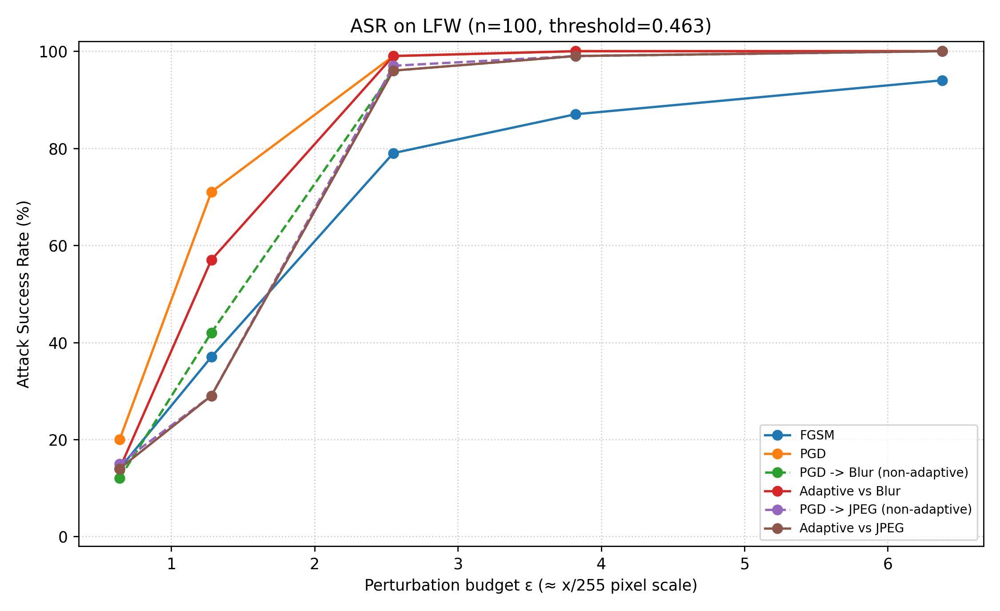
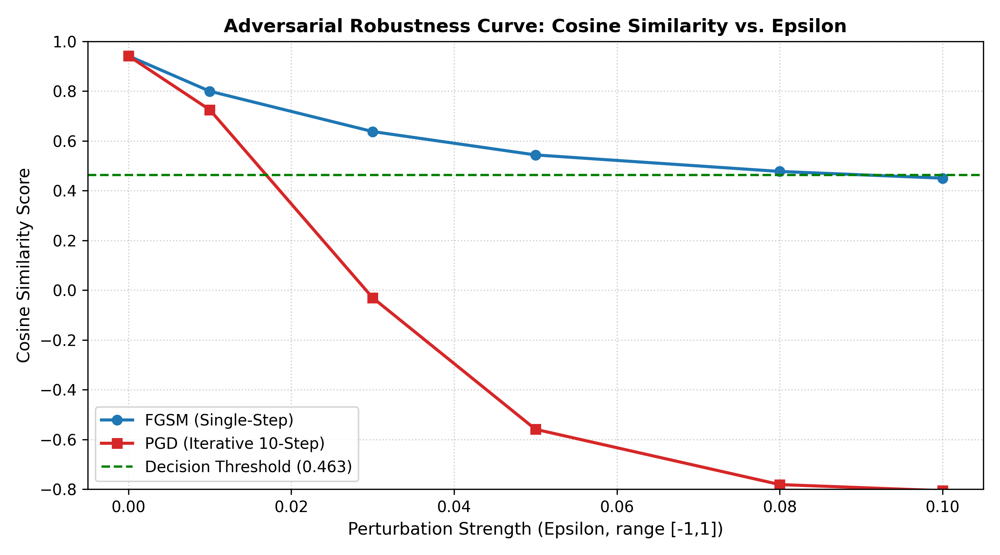

# Adversarial Robustness of Face Verification (FaceNet)

تقييم مرونة أنظمة التحقق البيومترية (التعرف على الوجه) ضد الهجمات العدائية.

Evaluates how well a pretrained face verification model (FaceNet / VGGFace2) resists
digital adversarial evasion attacks (FGSM, PGD) and simple preprocessing defenses
(Gaussian blur, JPEG), including **adaptive attacks** against those defenses.
The goal is to **measure and improve defenses**, not to bypass real systems.

## Project structure
| File | Purpose |
|---|---|
| `attacks.py` | Shared core: model, FGSM/PGD, defenses (Blur, JPEG), threshold loading |
| `lfw_eval.py` | Clean accuracy + threshold calibration on LFW (writes `threshold.json`) |
| `lfw_attack_eval.py` | ASR over many LFW pairs, with 95% confidence intervals |
| `attack_and_defense.py` | Single image pair: attacks vs. defenses (normal and adaptive) |
| `benchmark_evaluation.py` | Robustness curve (similarity vs. epsilon) for one pair |
| `app.py` | Streamlit dashboard (`streamlit run app.py`) |

## Setup
```bash
python3 -m venv venv
source venv/bin/activate
pip install -r requirements.txt
```

## Workflow
```bash
python lfw_eval.py --n 200                                   # 1) calibrate threshold
python lfw_attack_eval.py --n 100 --eps 0.005,0.01,0.02,0.03,0.05   # 2) ASR on LFW
python attack_and_defense.py --img1 a.jpg --img2 b.jpg       # single pair demo
streamlit run app.py                                         # dashboard
```

## Method notes
- Threat model: white-box, digital, L-infinity bounded evasion (dodging) of a 1:1 verification system.
- Images use the range [-1, 1]; `epsilon = 0.05` is about 6.4/255 in standard pixel scale.
- A defense is only considered robust if it survives an **adaptive** attack
  (differentiable attack through Blur, BPDA through JPEG), following Carlini et al. 2019.
- ASR is computed only on same-identity pairs that the system accepts without attack.

## Results

**Clean verification** (LFW test, 200 pairs, calibrated threshold = 0.463):
accuracy 97.5%, FAR 0.0%, FRR 4.85%, AUC 0.982.

**Attack success rate (ASR)**, LFW, n = 100 valid same-identity pairs, 10-step PGD:

| eps (≈ /255) | FGSM | PGD | PGD → Blur | Adaptive vs Blur | PGD → JPEG | Adaptive vs JPEG |
|---|---|---|---|---|---|---|
| 0.6 | 14% | 20% | 12% | 14% | 15% | 14% |
| 1.3 | 37% | 71% | 42% | 57% | 29% | 29% |
| 2.6 | 79% | 99% | 96% | 99% | 97% | 96% |
| 3.8 | 87% | 100% | 99% | 100% | 99% | 99% |
| 6.4 | 94% | 100% | 100% | 100% | 100% | 100% |

Full table with 95% confidence intervals: `results.csv`.




**Observations**
- PGD reaches 99% ASR at about 2.6/255, so the model is very fragile in the white-box setting.
- Blur and JPEG reduce ASR only at the smallest perturbation (about 1.3/255) and offer almost no protection beyond it.
- The adaptive attack raised ASR against Blur at 1.3/255 (42% → 57%); it did not improve on the non-adaptive attack against JPEG, which does not prove JPEG is robust, only that this 10-step BPDA attack did not break it further.

**Limitations**
- One model (FaceNet), digital white-box attacks only, simple defenses, n = 100 (95% CI about ±10%).
- FAR under defenses was not measured.

## Ethics
Public dataset (LFW) or volunteers' images with consent. No personal images in this repo.

## Author
Hussein Al-Azzawi - IT Department, Warith Al-Anbiyaa University, Karbala, Iraq